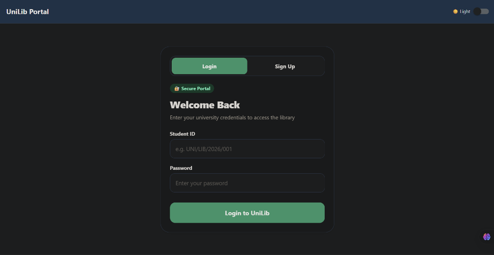
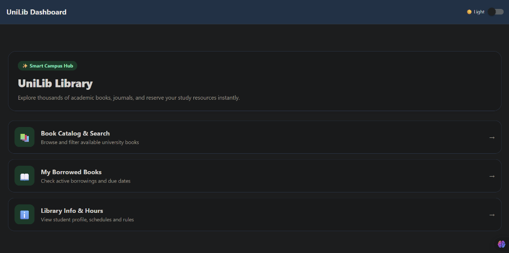
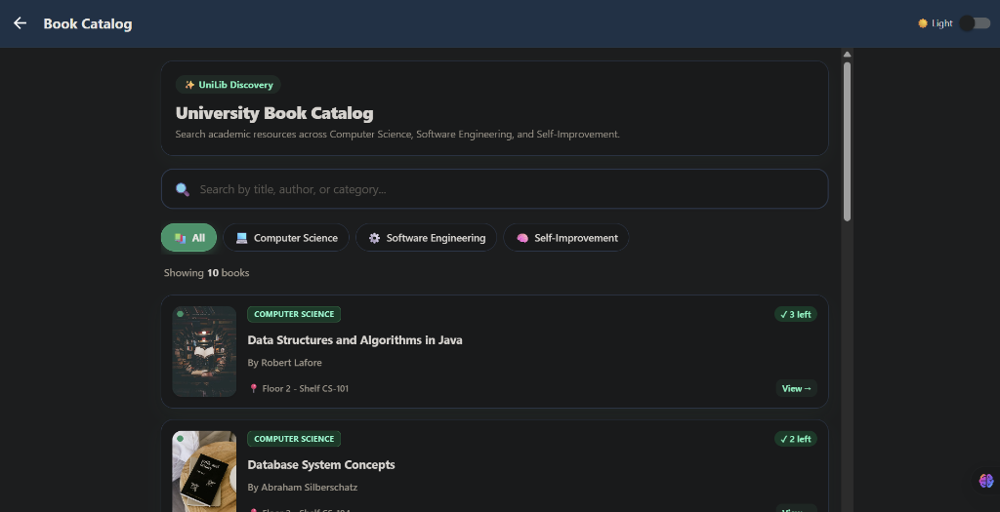
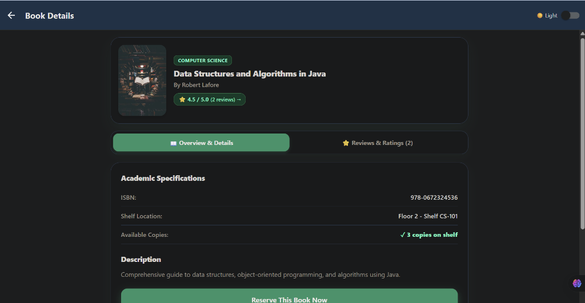
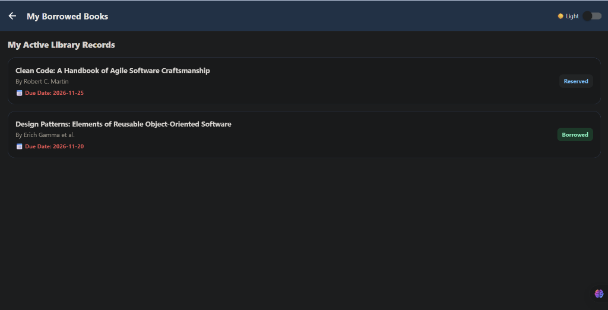
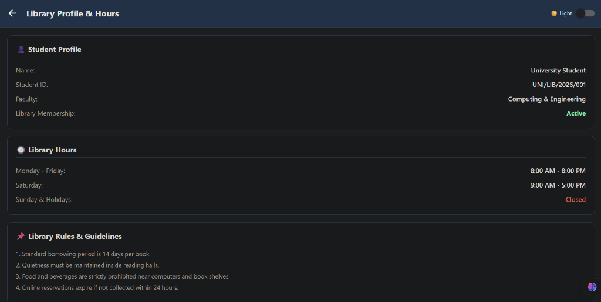
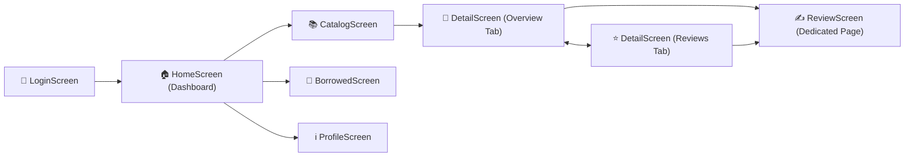

# 📚 UniLib — Smart Campus Library System

[](https://reactnative.dev/)
[](https://expo.dev/)
[](https://necolas.github.io/react-native-web/)
[](https://reactnavigation.org/)
[](LICENSE)
[](#)

> **UniLib** is a high-performance, responsive, cross-platform university library management system engineered with **React Native**, **Expo**, **React Navigation**, and **React Native Web**. Built with an **anti-gravity floating card aesthetic**, emerald accent highlights (`#10b981`), frictionless multi-platform scrolling, and complete dynamic Dark/Light theme integration.

---

## 📑 Table of Contents

- [Overview & Objective](#-overview--objective)
- [Key Features](#-key-features)
- [Screenshots & Visual Showcase](#-screenshots--visual-showcase)
- [Special Architectural Features](#-special-architectural-features)
  - [Anti-Gravity Floating Card Aesthetics](#1-anti-gravity-floating-card-aesthetics)
  - [Frictionless Multi-Platform Scrolling](#2-frictionless-multi-platform-scrolling)
  - [Centralized Data-Driven Architecture](#3-centralized-data-driven-architecture)
- [Technologies & Libraries Used](#-technologies--libraries-used)
- [Project Directory Structure](#-project-directory-structure)
- [Installation and Setup Instructions](#-installation-and-setup-instructions)
- [Application Flow & Screens](#-application-flow--screens)
- [Contributing](#-contributing)
- [License](#-license)

---

## 🎯 Overview & Objective

In higher education institutions, students and researchers need swift, frictionless access to academic literature, course modules, textbooks, and campus library availability across any device.

**UniLib** solves this challenge by delivering a single, unified codebase that operates natively across **iOS**, **Android**, and **modern Web browsers**. Whether browsing on an iPhone, an Android tablet, or a 4K desktop monitor, UniLib delivers native fluid scrolling, zero nested container lockups, real-time catalog filtering, interactive rating analytics, and instantaneous book reservations.

---

## ✨ Key Features

### 🔍 Real-Time Searchable Book Catalog
- **Multi-Field Real-Time Filtering**: Instant keyword search across book **titles**, **authors**, **ISBNs**, and **categories**.
- **Interactive Category Filter Pills**:
  - 📚 **All**
  - 💻 **Computer Science** (Algorithms, Database Systems, AI)
  - ⚙️ **Software Engineering** (Agile, Design Patterns, Clean Code, System Architecture)
  - 🧠 **Self-Improvement** (Atomic Habits, Deep Work, Mindset)
- **Active Results Counter & Quick Reset**: Live matching counter (e.g., `Showing 6 books in Software Engineering`) with one-click `Reset Filters` capability.
- **Empty State Guard**: Dedicated fallback component with clear action buttons when zero results match.

### 🌓 Seamless Dark & Light Theme Integration
- Global reactive theme state managed via `ThemeContext`.
- Header-level switch accessible across the entire navigation tree.
- High-contrast accessibility:
  - **Light Mode**: Crisp `#ffffff` elevated cards with slate borders (`#e2e8f0`) and subtle shadows.
  - **Dark Mode**: Deep `#0d1117` background with `#161b22` cards, `#30363d` borders, and high-visibility `#f0f6fc` typography.

### 📖 Interactive Dual-Tab Book Details Screen
- **Tab 1: Overview & Details**:
  - High-resolution floating book cover with status indicator.
  - Academic metadata table: ISBN, physical shelf location (e.g., `Floor 3 - Shelf SE-204`), and real-time stock count.
  - Full syllabus/course description.
  - Horizontal **Recent Student Feedback** scroll view previewing peer ratings.
  - Interactive **Reserve This Book Now** action button with live stock deduction.
- **Tab 2: Reviews & Ratings**:
  - **Ratings Scorecard**: Prominent numeric score (e.g., `⭐ 4.8 / 5.0`), visual star rating row, and student approval badge (`✓ 96% Student Approval`).
  - **Rating Distribution Breakdown**: Dynamic visual progress bars for 5★, 4★, 3★, 2★, and 1★ ratings with live percentage calculation.
  - **Interactive Review Submission Form**:
    - Student Registration ID verification input.
    - 5-Star interactive touch picker with real-time status labels (`⭐⭐⭐⭐⭐ Excellent (5/5)`).
    - Multiline feedback comment area.
    - Instant list prepend upon submission without page reloads.
  - **Verified Community Reviews List**: Card-based review stream displaying student badges, star pills, comments, and timestamps.

### 📋 Active Borrowing Records & User Profile
- **Active Borrowings (`BorrowedScreen`)**: Tracks active student loans with due dates, warning badges, and reservation records.
- **Library Profile & Operational Hours (`ProfileScreen`)**: View student membership credentials, campus library opening hours, and book borrowing quotas.

---

## 📸 Screenshots & Visual Showcase

> *Note: Replace the placeholders below with actual screenshots of your UniLib app in action.*


### 📱 Mobile Experience (iOS & Android)

Explore the UniLib mobile application through its intuitive and responsive user interface.

#### 🔐 Authentication & Dashboard

| 1. Login Screen | 2. Smart Hub Dashboard | 3. Book Catalog |
| :---: | :---: | :---: |
|  |  |  |
| *Secure student authentication* | *Personalized student dashboard* | *Real-time book search and filters* |

#### 📚 Book Details & Reviews

| 4. Book Details | 5. Reviews & Ratings | 6. Borrowed Books |
| :---: | :---: | :---: |
|  |  |  |
| *Book specifications and reservations* | *Interactive student reviews and ratings* | *Track active loans and due dates* |

#### 👤 Student Profile & Dark Mode

| 7. Library Profile & Hours | 8. Dark Mode |
| :---: | :---: |
|  |  |
| *Student profile and library hours* | *Seamless dark theme experience* |

---


### 💻 Web & Desktop Experience (React Native Web)

| 1. Student Authentication Portal | 2. Smart Campus Dashboard |
| :---: | :---: |
|  |  |
| *Secure student login with dual-tab authentication & dark mode* | *Central hub with shortcuts to Catalog, Loans, and Library Profile* |

| 3. Real-Time Book Catalog & Search | 4. Interactive Book Details & Overview |
| :---: | :---: |
|  |  |
| *Real-time category pills (CS, SE, Self-Improvement) and instant search* | *Academic specifications table, shelf locations & instant reservation* |

| 5. Active Borrowed Records | 6. Library Hours & Student Profile |
| :---: | :---: |
|  |  |
| *Track active loans, due dates, and reserved book statuses* | *Verified student profile, weekly library schedule & circulation rules* |

---

## 🚀 Special Architectural Features

### 1. Anti-Gravity Floating Card Aesthetics
The UI incorporates a modern, elevated card paradigm inspired by anti-gravity design principles:
- **Rounded Corners**: Generous `borderRadius: 16` to `24` across all interactive surfaces.
- **Emerald Brand Palette**:
  - Primary Emerald: `#10b981`
  - Emerald Glow / Highlights: `rgba(16, 185, 129, 0.12)` to `rgba(16, 185, 129, 0.35)`
  - Active Pills: `#10b981` with crisp `#ffffff` typography.
- **Multi-Layered Floating Shadows**:
  - **Android**: Custom `elevation` layering (2 to 4).
  - **iOS**: `shadowColor: '#000'`, `shadowOffset: { width: 0, height: 6 }`, `shadowOpacity: 0.08`, `shadowRadius: 14`.
  - **Web**: Smooth multi-stop CSS `boxShadow` with emerald-tinted ambient occlusion (`0 10px 25px -4px rgba(16, 185, 129, 0.08), 0 4px 12px rgba(0, 0, 0, 0.05)`).

### 2. Frictionless Multi-Platform Scrolling
A frequent pitfall in cross-platform React Native development is nested container height traps and `100vh` overflow collisions on web browsers. UniLib solves this natively:
- **Single Virtualized List Container**: The Catalog screen routes search inputs, banners, category chips, and result counters into `FlatList.ListHeaderComponent`, guaranteeing **zero** nested vertical scroll conflict warnings.
- **Web Flexbox `minHeight: 0` Strategy**: Overrides the browser flexbox default (`min-height: auto`), allowing inner scroll components to shrink and scroll without expanding past the viewport boundary.
- **Dynamic Bottom Padding Buffer**: Applied inside `contentContainerStyle` (`paddingBottom: 60 - 80px`) to prevent bottom list items from being obstructed by mobile home indicators or browser status bars.
- **Inertia Scrolling**: Web-specific acceleration enabled via `WebkitOverflowScrolling: 'touch'`.

### 3. Centralized Data-Driven Architecture
- **Single Source of Truth (`/data/books.js`)**: All books are structured as immutable catalog entities with full academic attributes (`isbn`, `category`, `shelf`, `availableCopies`, `description`, `image`).
- **Reactive State Flow**: When a student reserves a book or publishes a review, local state recomputes available copies, average ratings, and distribution charts dynamically.

---

## 🛠 Technologies & Libraries Used

| Technology / Library | Version | Role in Project |
| :--- | :--- | :--- |
| **React** | `19.3.0` | Core UI library & reactive hook architecture (`useState`, `useMemo`, `useCallback`) |
| **React Native** | `0.88.1` | Cross-platform native mobile application framework |
| **Expo** | `~58.0.22` | Universal application toolchain, bundler, and development environment |
| **React Native Web** | `^0.21.4` | Web compile target translating React Native primitives to standard HTML/CSS DOM |
| **@react-navigation/native** | `^7.5.1` | Declarative routing and navigation container |
| **@react-navigation/stack** | `^7.12.1` | Native stack transition navigator with header theme controls |
| **react-native-safe-area-context** | `~5.10.1` | Notch, dynamic island, and gesture bar inset management |
| **react-native-screens** | `~4.30.1` | Native memory management and screen lifecycle optimization |

---

## 📂 Project Directory Structure

```text
UniLib_pro/
│
├── UniLibApp/                          # Primary Application Root
│   ├── assets/                         # Application branding, adaptive icons & splash
│   ├── data/
│   │   └── books.js                    # Central academic book catalog database
│   ├── screens/
│   │   ├── LoginScreen.js              # Student portal login with auth tabs
│   │   ├── HomeScreen.js               # Smart campus hub dashboard
│   │   ├── CatalogScreen.js            # Frictionless catalog with real-time filtering
│   │   ├── DetailScreen.js             # Dual-tab details & review system
│   │   ├── DetailsScreen.js            # Re-export compatibility alias
│   │   ├── ReviewScreen.js             # Standalone dedicated rating & feedback form
│   │   ├── BorrowedScreen.js           # Student active borrowings & due dates
│   │   └── ProfileScreen.js            # Student profile, library schedules & rules
│   ├── ThemeContext.js                 # Global Dark/Light Theme Provider & hook
│   ├── App.js                          # Stack navigator and root application entry
│   ├── app.json                        # Expo configuration manifest
│   ├── index.js                        # AppRegistry entry point
│   └── package.json                    # Dependencies, scripts and engines
│
└── README.md                           # Comprehensive documentation & landing page
```

---

## 💻 Installation and Setup Instructions

Follow these step-by-step instructions to get UniLib running locally on your workstation or device.

### Prerequisites

Ensure you have the following installed on your machine:
- **Node.js**: `v18.x` or higher ([Download Node.js](https://nodejs.org/))
- **npm** (comes with Node.js) or **yarn**
- **Expo Go App** (optional, for physical iOS/Android device testing from the App Store / Google Play)
- **Git**: ([Download Git](https://git-scm.com/))

### 1. Clone the Repository

```bash
git clone https://github.com/Pavan-kavinda/UniLibApp.git
cd UniLibApp
```

### 2. Install Project Dependencies

Install the project dependencies using `npm`:

```bash
npm install
```

### 3. Launch the Application

Start the Expo development server:

```bash
npx expo start
```

### 4. Running on Specific Target Platforms

#### 🌐 Running in the Web Browser
Press `w` in the terminal or run:
```bash
npx expo start --web
```
The app will bundle and open automatically in your browser at `http://localhost:8081`.

#### 📱 Running on Android Device / Emulator
Press `a` in the terminal or run:
```bash
npx expo start --android
```

#### 🍎 Running on iOS Simulator (macOS only)
Press `i` in the terminal or run:
```bash
npx expo start --ios
```

#### 📲 Testing on Physical Devices
1. Install **Expo Go** on your iOS or Android device.
2. Ensure your computer and mobile device are connected to the same Wi-Fi network.
3. Scan the QR code displayed in the terminal with your mobile camera (iOS) or the Expo Go app (Android).

---

## 🔄 Application Flow & Screens



1. **Login Portal (`LoginScreen.js`)**: Initial landing screen where students enter their credentials to access university resources.
2. **Dashboard (`HomeScreen.js`)**: Quick navigation hub highlighting current borrowing summaries and directory shortcuts.
3. **Book Catalog (`CatalogScreen.js`)**: Fast, real-time filtered catalog with anti-gravity emerald cards.
4. **Book Details (`DetailScreen.js`)**: Multi-tab hub containing book specs, reservation buttons, reviews list, and dynamic feedback forms.
5. **Rating Screen (`ReviewScreen.js`)**: Full-screen feedback flow for in-depth course and textbook reviews.
6. **Active Loans (`BorrowedScreen.js`)**: Overview of all active student borrowings, due dates, and return statuses.
7. **Profile (`ProfileScreen.js`)**: Student identity card, library operational schedule, and facility guidelines.

---

## 🤝 Contributing

Contributions, issues, and feature requests are welcome! Feel free to check the [issues page](https://github.com/Pavan-kavinda/UniLibApp/issues).

1. Fork the Project
2. Create your Feature Branch (`git checkout -b feature/AmazingFeature`)
3. Commit your Changes (`git commit -m 'feat: Add some AmazingFeature'`)
4. Push to the Branch (`git push origin feature/AmazingFeature`)
5. Open a Pull Request

---

## 📄 License

Distributed under the **MIT License**. See [`LICENSE`](LICENSE) for more information.

---

<p align="center">
  Built with 💚 for university students and academic communities.
</p>
